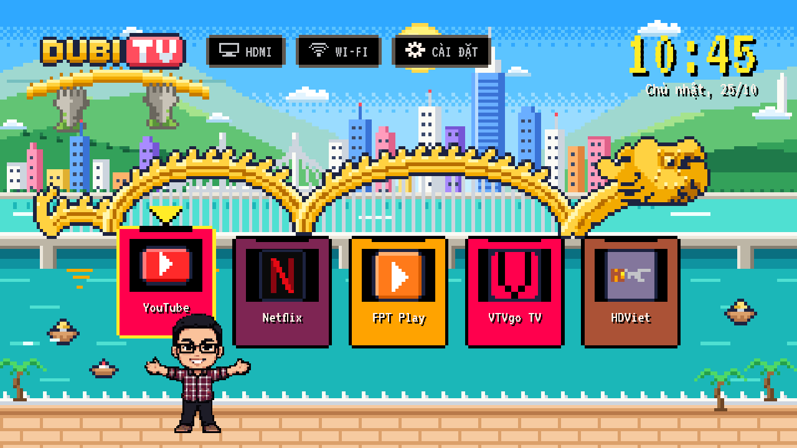
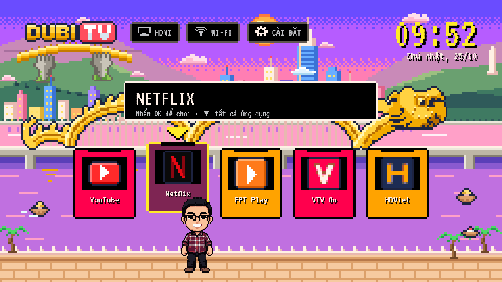
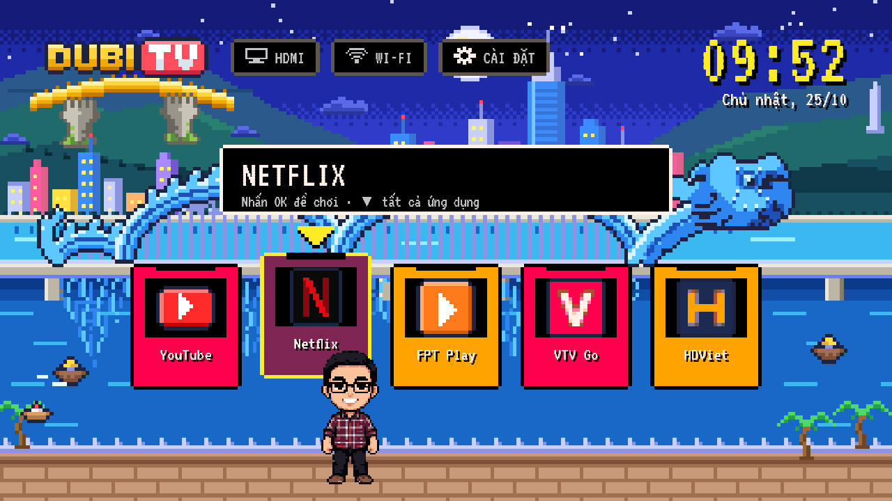
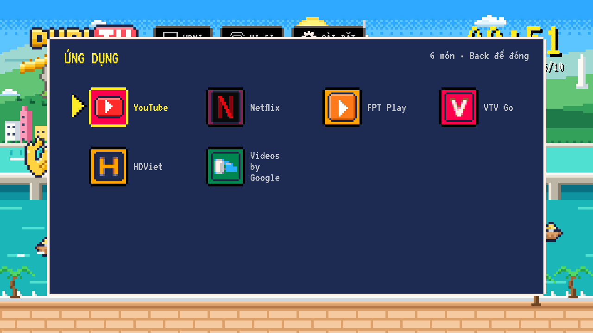
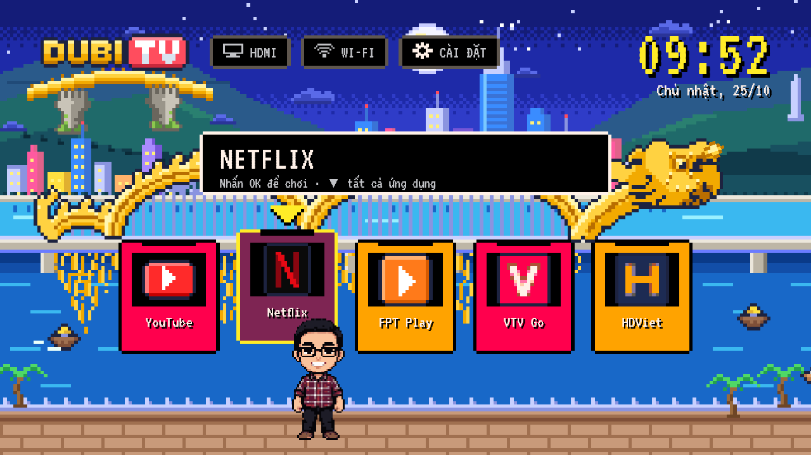
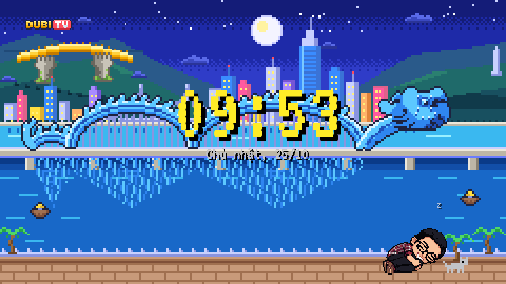

# Dubi TV

A tiny pixel-art home launcher for Android TV, made for an older Sony BRAVIA (Android TV 8.0, 1.6 GB RAM).
The Home screen is a bright Da Nang scene - the Dragon Bridge over the Han River, the Golden Bridge on Bà Nà hills, boats and the city - with a chibi character who walks to whichever app you pick.

*Launcher pixel art cho Android TV đời cũ: cảnh Đà Nẵng, Cầu Rồng, Cầu Vàng và một nhân vật chibi đi theo ứng dụng đang chọn. Nhẹ hơn launcher gốc nhiều lần.*



| Dusk | Night |
|---|---|
|  |  |

| All apps | Weekend Dragon Bridge show (21:00 Sat/Sun) |
|---|---|
|  |  |

| Boot | Screensaver |
|---|---|
|  |  |

## Why

The stock Android TV launcher on a 2015 TV is slow and heavy.
Dubi TV keeps only what a family uses - a dock of favourite apps, the full app list, HDMI inputs, Wi-Fi and Settings - and draws everything as pixel art that costs almost nothing to render.

Measured on the real TV (Sony BRAVIA 2015, Android 8.0):

| | Stock launcher | Dubi TV |
|---|---|---|
| Memory at Home (PSS) | ~92 MB | **~19 MB** |
| Janky frames while moving focus | - | **0%** (p90 9 ms) |
| APK size | - | **~180 KB** |

## Features

- Day, dusk and night scenes that follow Vietnam time (UTC+7), even when the TV's own time zone is wrong.
- A dock of hand-drawn pixel icons for the apps used most; every other app's icon is pixelised automatically once and cached.
- The character walks under the focused app, waves, and falls asleep on the screensaver (after 5 minutes).
- The app name shows when you move and fades out after about 2.5 s, so the bridge stays visible.
- Settings opens the TV's own settings directly; HDMI and Wi-Fi have quick panels.
- The Dragon Bridge breathes fire and water at 21:00 on Saturdays and Sundays, like the real one.
- No internet permission, no analytics, no background services; idle Home draws no frames.

## Build

Needs JDK 17 and an Android SDK with platform 34 and build-tools 34 (`local.properties` -> `sdk.dir`).

```sh
./gradlew :app:testReleaseUnitTest :app:assembleRelease
# -> app/build/outputs/apk/release/app-release.apk (signed with the debug key)
```

## Install and make it Home

```sh
adb install -r app/build/outputs/apk/release/app-release.apk
# The stock launcher's HOME filter has a system priority, so a third-party Home only wins once it is disabled:
adb shell pm disable-user --user 0 com.google.android.tvlauncher
adb shell input keyevent KEYCODE_HOME
# Undo: adb shell pm enable com.google.android.tvlauncher
```

## How it is built

- One plain `Activity` (no AndroidX, no Compose) hosting one custom `View` (`LauncherView`) that draws the whole 1920x1080 stage on a hardware canvas.
  Pixel art is decoded at 1x and scaled by the GPU with nearest-neighbour sampling at whole-number scales (backdrop 8x, character 4x, logotype 4x/8x/16x).
- Every animation is stepped. Instead of a 60 fps loop, each animation reports when its next step lands and the view sleeps until then, on a shared 40 ms grid.
  All loops pause 5 s after the last key, while an app is open and on the screensaver.
- Apps come from `PackageManager` (leanback launch intents).
  Icons for apps outside the dock are pixelised once per app version (`Pixelizer`) on a background thread and cached as 16x16 PNGs; muddy results get a brand-colour fallback tile.
- Only `ACCESS_WIFI_STATE` / `ACCESS_NETWORK_STATE` are requested, for the Wi-Fi panel's status line.

## Debug keys (USB/Bluetooth keyboard or `adb shell input keyevent`)

`S` screensaver now, `R` replay boot, `T` cycle day/dusk/night, `F` dragon show, `G` travel pose.

## Emulator stand-ins

`tools/stubapps` builds tiny stand-in apps with the real package names and labels (YouTube, Netflix, FPT Play, VieON, Spotify, VTV Go, HDViet) for checking the dock and launch/back on an emulator: `./gradlew :stubapps:assembleDebug`.
Never install them on a real TV.

## Notes

App names and icons shown in the dock are trademarks of their owners; the pixel icons are fan-made for personal use.
